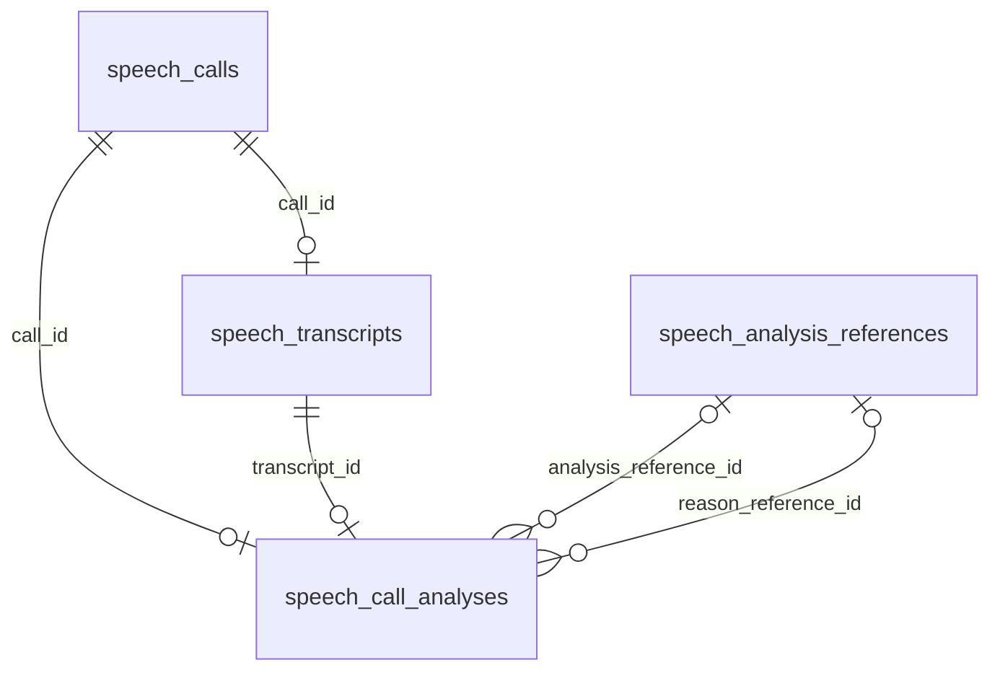

# Хранение актуального результата анализа

Дата проектирования: 14.10.2026. Добавочная схема, ORM и DTO реализованы
ревизией `sp_0017_analysis_storage` после `sp_0016_evaluation_jobs`.
Писатели анализа/причин одной транзакцией сохраняют новые таблицы и прежние
поля звонка. Читатели пока используют прежнюю проекцию; массовый перенос
данных и удаление колонок не выполнены. На рабочих БД миграция не запускалась.
Фактические метаданные LLM, DTO вычисления и атомарная запись реализованы
14.10.2026: [запись и гарантии](analysis-persistence.md).
Общее направление согласовано в [плане модели данных](data-model-plan.md).

## Граница первой задачи

Выносим проверенный результат LLM из `speech_calls` в `speech_call_analyses`.
Для первого этапа сохраняем существующее поведение: один актуальный результат
на звонок. Полный повторный анализ снимает прежний результат, затем публикует
новый. Выбор актуального результата не зависит от `MAX(created_at)`.

Уточнение владельца 14.10.2026: сравнение моделей/результатов не требуется.
Храним один актуальный анализ; архив предыдущих успешных версий для сравнения
не добавляем. Сведения о модели и промпте нужны для диагностики текущего
результата. История запусков/ошибок из общего плана — отдельная задача;
сведения о текущем успешном запросе не заменяют журнал всех попыток.

Существующие команды сравнения перечислены ниже как обнаруженные потребители
полей при миграции. Новые функции сравнения и хранение их результатов
в текущую реализацию не входят.

В этот шаг не входят редактор классификатора, замена очереди, отказ воркера
от SQL, полная история расшифровок и новая политика сроков хранения.

## Что показал аудит

| Потребитель | Текущая операция | Что сохранить при переносе |
| --- | --- | --- |
| [CPU-сценарий](../src/application/analysis/processing.py), [его репозиторий](../src/infrastructure/persistence/analysis_processing.py) | Читает согласованный вход, проверяет lease/nonce и снимок, завершает задание | LLM вне транзакции, результат и `done` вместе, устаревший ответ ничего не записывает |
| [Запись анализа](../src/infrastructure/persistence/stages/analyze.py) | Меняет поля звонка, иногда роли/метод ролей; снимает оценки при назначении ролей | Сохранение проектных измерений, ограничения ролей и атомарность всех эффектов |
| [Заполнение причин](../src/application/reasons/batch.py), [его SQL](../src/infrastructure/persistence/reasons.py) | Отдельный LLM-запрос заполняет пустую причину, в том числе без готового полного анализа | Частичный результат не становится успешным полным анализом; нельзя приписывать его другой модели |
| [Повторная обработка](../src/infrastructure/persistence/reprocessing.py), [отбор на повтор](../src/infrastructure/persistence/reanalyze.py) | Очищает производные поля; сохраняет проектные значения; сбрасывает только роли LLM | Результат снимается вместе с постановкой повтора, текст сохраняется при повторе только анализа |
| [Приём ASR](../src/infrastructure/persistence/transcription_delivery.py), [запись текста](../src/infrastructure/persistence/stages/transcribe.py) | Заменяет расшифровку/реплики, инвалидирует анализ и ставит следующий этап | Результат старой расшифровки не остаётся актуальным после нового ASR |
| [Карточка и статистика](../src/infrastructure/persistence/calls_operations.py) | Читает классификацию, тональность, резюме, причины и источники измерений | Форма ответа, доступность звонка без анализа, различие операторской и модельной классификации |
| [Поиск](../src/infrastructure/persistence/search.py) | Фильтрует по ветке ИИ; возвращает тональность и измерения | Те же страницы, счётчики и знаменатель доли, включая звонки без анализа |
| [Дашборд](../src/infrastructure/persistence/dashboard.py) | Группирует звонки по узлу ИИ, считает негатив | Один звонок учитывается один раз; даты/источник берутся из звонка |
| [SQL отчёта и XLSX](../src/infrastructure/reports/calls.py), [сценарий отчётов](../src/infrastructure/persistence/reports_operations.py) | Читают те же поля напрямую, считают классификации и причины | Переключить также SQL внутри пакета `reports`, а не только `persistence` |
| [Выборки сравнения](../src/infrastructure/persistence/comparison.py), [сравнение](../src/application/comparison/service.py) | Читают сохранённый анализ; считают кандидат/контроль на одном DTO без записи | Сравнение не меняет актуальный результат |
| [Оценка](../src/infrastructure/persistence/stages/evaluate.py), [роли оценки](../src/infrastructure/persistence/evaluation.py) | Может назначать роли и сохраняет собственный результат | `summary` оценки — другое поле; саму таблицу оценок не переносим в таблицу анализа |
| [Очистка](../src/domain/retention/policy.py) | Удаляет завершённые задания через 30 дней, аудит через 365; аудио имеет отдельный срок | Удаление задания не должно удалять актуальный анализ или сведения о его модели |

Это статическая проверка нового бэкенда и точек совместимости воркера,
не измерение данных рабочей БД. Старые репозитории не использовались.

## Предлагаемая схема

`speech_call_analyses` — текущий набор результатов разбора. Он может содержать
только причину, если отдельная команда успела заполнить её раньше полного
анализа. Наличие строки не означает `analysis_status = done`.

`speech_analysis_references` — неизменяемый снимок справочников, реально
использованных моделью. Одинаковые снимки переиспользуются по хешу: всё дерево
не дублируется для каждого звонка. Это фиксация входа, не второй редактируемый
классификатор и не история всех результатов.

### Таблица speech_call_analyses

`NULL` ниже означает допустимое отсутствие значения, а не подстановку.

| Поле | Тип и обязательность | Назначение |
| --- | --- | --- |
| `id` | UUID, PK, NOT NULL | Идентичность текущей записи; при снятии и новом создании назначается новый UUID |
| `call_id` | UUID, UNIQUE, NOT NULL | FK на `speech_calls.id`, `ON DELETE CASCADE`; не более одной строки на звонок |
| `transcript_id` | UUID, NOT NULL | Связь с конкретной существующей расшифровкой этого звонка |
| `revision` | bigint, NOT NULL, начиная с 1 | Увеличивается при изменении текущей записи; защита частичного дополнения от конкурентной записи |
| `binding_kind` | varchar(16), NOT NULL | `verified` для нового вычисления; `legacy_observed` для переноса прежних полей без доказанного исходного входа |
| `ai_node_id` | UUID, NULL | FK на узел классификатора, `ON DELETE RESTRICT` |
| `ai_path` | JSONB, NULL | Проверенный путь из `AnalyzeWork.path`; для старых данных — наблюдённый при переносе путь |
| `ai_suggestion` | JSONB, NULL | Предложение модели, до пяти строк с действующими правилами длины |
| `ai_suggestion_node_id` | UUID, NULL | FK на узел, только если предложение целиком найдено в дереве; `RESTRICT` |
| `sentiment` | varchar(16), NULL | Только `negative`, `neutral`, `positive` либо отсутствие значения |
| `summary` | text, NULL | Резюме; новые значения проходят действующий предел 300 символов |
| `llm_segment`, `llm_product` | varchar(16), NULL | Предложения LLM в действующих перечислениях, независимо от проектного значения звонка |
| `call_reason` | text, NULL | Причина со стороны клиента, действующий предел 200 символов |
| `call_reason_code` | varchar(8), NULL | FK на `speech_call_reasons.code`, `ON DELETE RESTRICT` |
| `analysis_reference_id` | UUID, NULL | FK на снимок справочников полного анализа, `RESTRICT`; неизвестен для старых результатов |
| `reason_reference_id` | UUID, NULL | FK на снимок запроса, давшего текущую причину, `RESTRICT` |
| `analysis_provenance` | JSONB, NULL | Строгий DTO происхождения полного анализа; отсутствует у записи только с причиной |
| `reason_provenance` | JSONB, NULL | Происхождение текущей причины, включая отдельный запрос дополнения |
| `created_at`, `updated_at` | timestamptz, NOT NULL | Время создания/изменения записи в хранилище; не выдаём его за неизвестную дату старого анализа |

Для связи с текстом добавляется `UNIQUE(call_id, id)` у `speech_transcripts`
и составной FK `(call_id, transcript_id)` на `(call_id, id)` этой таблицы,
`ON DELETE CASCADE`. Поэтому запись не может ссылаться на текст чужого звонка.
Удаление старой расшифровки снимает её текущий анализ; это соответствует
существующему пути переобработки и приёма нового ASR.

Срок хранения текста сейчас не удаляет расшифровки: действующая очистка
касается заданий, аудита и аудио. Если понадобится удалять текст, сохраняя
анализ, данную связь/политику каскада нужно пересмотреть отдельной задачей.

В БД проверяем положительную `revision`, значения технических перечислений,
тип массивов/объектов JSONB и длину причины. Pydantic DTO дополнительно
проверяют структуру путей, длины и согласованность происхождения. Старые
значения не обрезаем молча для прохождения новых ограничений: отклонения
попадают в отчёт подготовки переноса.

Для `verified` нужен хотя бы один вычисленный компонент с происхождением
`llm`. Полный анализ требует `analysis_provenance`, `analysis_reference_id`
и пригодную тональность; частичная причина — `reason_provenance` и
`reason_reference_id`. Текст причины и код проверяются независимо, как сейчас.
Дополнение причины у старого анализа не делает его неизвестный полный вход
доказанным: `binding_kind` остаётся `legacy_observed` до полного вычисления.

Индексы первой реализации: PK, уникальный `call_id`, частичные индексы
`(ai_node_id, call_id)` и `(call_reason_code, call_id)` для непустых значений,
индексы ссылок `analysis_reference_id`/`reason_reference_id` для поиска
используемых снимков. Даты и источник остаются индексированными в звонке.
Индексы на JSONB и дополнительные комбинации добавляются по планам реальных
запросов; перенос проверяется через `EXPLAIN` на отдельной тестовой БД.

### Таблица speech_analysis_references

| Поле | Тип и обязательность | Назначение |
| --- | --- | --- |
| `id` | UUID, PK, NOT NULL | Идентификатор неизменяемого снимка |
| `schema_version` | smallint, NOT NULL, положительный | Версия DTO и канонизации снимка |
| `fingerprint` | varchar(64), NOT NULL | SHA-256 канонического документа, ровно 64 строчных hex-символа |
| `payload` | JSONB, NOT NULL, объект | Строгий DTO справочников и сведений об их фактической передаче |
| `created_at` | timestamptz, NOT NULL | Момент первого сохранения этого снимка |

Уникальность — `(schema_version, fingerprint)`. При конфликте возвращаем
существующий снимок, не изменяя его содержимое; несовпадение содержимого
при одинаковом ключе — ошибка целостности.

Для сценария `analysis` DTO содержит снимок узлов `ClassifierRecord`,
который использовал интерпретатор, и фактически переданный справочник причин.
Для сценария `reason` — только справочник причин. Отдельно указывается,
почему причины не отправлялись: справочник пуст либо превышен предел.
Выключенные узлы и их положение сохраняются в снимке; дерево для LLM
строится теми же правилами `ClassifierIndex`, что и сейчас.

Ключи `payload` версии 1: `scenario` (`analysis`/`reason`),
`classifier` (массив `ClassifierRecord`, пустой для `reason`),
`reasons` (массив `CallReason`, именно отправленные записи),
`reason_reference_state` (`sent`, `empty`, `omitted_too_large`). Для `sent`
массив причин непустой; иначе пустой. Непереданный большой справочник не
выдаётся за справочник, по которому проверен ответ. Его изменения всё равно
учитывает исходный `AnalysisSnapshot.fingerprint` при проверке записи.

Канонизация сортирует узлы по UUID, причины по коду и ключи объектов;
значимые поля `parent_id`, `level`, `key`, `sort_order`, `is_active` входят
в хеш. Удалять использованный снимок нельзя. Очистка неиспользуемых снимков
проектируется с общей политикой хранения; автоматический TTL здесь не вводим.

### Происхождение результата

JSONB метаданных имеет версию и проверяется отдельным Pydantic DTO с
`extra="forbid"`. Это явная схема, а не произвольный `dict`.

DTO нового вычисления имеет следующие поля. Все обязательны, кроме явно
допускающих `NULL`.

| Поле | Тип / значение |
| --- | --- |
| `schema_version`, `origin` | `1`, `llm` |
| `execution_id` | UUID конкретного успешного HTTP-вызова, назначенный клиентом |
| `scenario`, `profile` | `analysis`/`reason`, `production`/`candidate` |
| `requested_model` | Непустая строка из отправленного `PreparedModelRequest.model` |
| `served_model`, `model_digest` | Строка либо `NULL`, если провайдер не сообщил |
| `prompt_version`, `rules_version` | Непустые строки; версии шаблона и интерпретатора |
| `prompt_digest` | SHA-256 канонического `PromptTemplate`, включая переменные и сообщения |
| `request_fingerprint` | SHA-256 фактически отправленного JSON запроса: модель, сообщения и параметры |
| `temperature`, `max_tokens` | Число 0–2, целое 1–32768 из фактического запроса |
| `transcript_id`, `transcript_created_at` | UUID и время с часовым поясом исходной расшифровки |
| `fingerprint_schema` | `analysis-snapshot/1` либо `reason-snapshot/1` |
| `source_fingerprint` | SHA-256 исходного DTO по указанной схеме |
| `committed_transcript_fingerprint` | SHA-256 применённого состояния по `transcript-state/1`, допускается `NULL`; новый писатель заполняет, причина полного анализа переиспользует то же происхождение |
| `started_at`, `finished_at` | Время с часовым поясом; получение пригодного ответа не раньше начала вызова |
| `model_call_index` | Положительное целое: номер HTTP-вызова внутри вычисления |
| `job` | Объект `{job_id: UUID, claim_token: UUID, attempt: int >= 1}` для очереди; `NULL` для ручного дополнения |

Для `analysis-snapshot/1` используется канонизация существующего
`AnalysisSnapshot.fingerprint`. `reason-snapshot/1` включает UUID/дату
транскрипта, метод ролей, `seq`/`speaker`/`text_raw` упорядоченных реплик
и отправленные причины. `transcript-state/1` включает UUID/дату, метод ролей и эти поля
реплик после применения собственных ролей; справочников в нём нет.
Все SHA-256 — 64 строчных шестнадцатеричных символа. Семантическое изменение
канонизации требует новой версии; несовпадение версий не трактуем как равенство.

Отданное провайдером имя/дайджест модели записывается отдельно, если он
предоставлен. Имя модели в запросе не доказывает конкретную сборку весов.
Секреты, заголовки авторизации, URL с токенами, сырые ответы и дубликаты
разговора в метаданные не помещаем. Хеш без исходного текста не обеспечивает
полное воспроизведение после удаления текста.

При переносе используем вариант `origin = legacy_import` с временем импорта
и перечнем неизвестных данных. Модель, версии, исходный снимок и реальное
время анализа остаются неизвестными. Текущие Settings, справочники и
`speech_calls.updated_at` не являются доказательствами старого запроса.

Его точные ключи: `schema_version = 1`, `origin = legacy_import`,
`source = speech_calls`, `imported_at` (время с часовым поясом),
`unknown_fields` (массив имён отсутствующих сведений). Поля нового LLM-варианта
этому варианту не подставляются. Обе формы задаются различаемым по `origin`
объединением Pydantic моделей.

`analysis_provenance` и `reason_provenance` разделены: дополнение причины
другой моделью не меняет сведения о модели классификации/резюме.
Причина, полученная в полном анализе, ссылается на происхождение этого анализа.
Успешный разбор без кода причины остаётся успешным; текст причины без кода
допустим по существующим правилам `interpret_reason`.

## Что остаётся в speech_calls

Сохраняются метаданные, источник, время звонка, ссылка на аудио, операторская
классификация (`operator_node_id`, `disposition`), `processing_status`,
`analysis_status`, `completed_at` и эффективные `segment`/`product` с их
источниками. Это состояние процесса и факты звонка.

Проектный сегмент/продукт имеют прежний приоритет. Таблица анализа хранит
предложение LLM, а бэкенд обновляет эффективную проекцию в звонке по текущим
правилам `CASE ... source = project`. При снятии анализа сбрасываются только
значения LLM; проектные сохраняются. Для старых строк предложение LLM,
когда оно было перекрыто проектом, неизвестно — не копируем туда проектный факт.

После переключения убираются дубли `ai_node_id`, `ai_suggestion`,
`ai_suggestion_node_id`, `sentiment`, `summary`, `call_reason`,
`call_reason_code`. Поля `topic_id`, `ai_topic_id`, `ai_topic_label` и
`speech_topics` остаются для отдельного аудита старой разметки. Их отсутствие
в действующих читателях не разрешает удалять исторические данные этим шагом.

## Запись, актуальность и частичные результаты

### Полный анализ

Существующий порядок захвата/блокировок и проверки `AnalysisSnapshot`
сохраняется. В одной короткой транзакции после HTTP:

1. Проверяем живой nonce, владельца, попытку, занятость этапов и исходный снимок.
2. Сохраняем/переиспользуем фактически использованный снимок справочников.
3. Публикуем текущий анализ и его происхождение; обновляем проектную проекцию
   измерений по прежним правилам.
4. Применяем роли, метод ролей и снятие оценок тем же порядком, что сейчас.
5. Завершаем то же задание и состояния звонка; последний UPDATE проверяет lease.
   Любой отказ/ошибка commit откатывает все перечисленные действия.

Текущий хеш включает роли и справочники. Проверку входа делаем **до**
применения собственных ролей модели; иначе результат сам сделает свой вход
«устаревшим». В происхождении можно хранить отдельный отпечаток состояния
транскрипта после применения ролей. Его версия и состав явно заданы и не
смешиваются с отпечатком исходного снимка `AnalysisSnapshot`.

Смена справочника после успешного commit не снимает весь накопленный анализ:
новое дерево используется следующими запросами. Переобработка — явная команда.
Изменения ролей отдельной оценкой сохраняют нынешнее поведение и не вводят
скрытую массовую постановку анализа; происхождение фиксирует именно вход
состоявшегося разбора. Новую политику зависимостей ролей можно вводить отдельно.

### Дополнение причины

`speech-fill-reasons` сохраняет свои аргументы, отбор и отдельный короткий
запрос модели. Он не должен превращаться в полный повторный анализ или
перезаписывать классификацию, тональность, резюме и происхождение этих полей.

До LLM читаются UUID/дата расшифровки, реплики, справочник и ожидаемые
`id`/`revision` текущего результата. Запись блокирует звонок и сверяет текст,
роли, доступность кодов и ожидаемую запись. Проверяются и `id`, и `revision`:
после удаления/создания строки счётчик мог снова стать равен 1.
Если код уже заполнен или вход/результат изменился, ответ не применяется.
Эта проверка реализована при подключении записи; прежний SQL проверял только
`call_reason_code IS NULL`, без сравнения снимка после LLM.

При отсутствии строки создаётся частичный результат. Во время совместимой
записи, если в старых колонках уже есть полный анализ, сначала переносится
именно его проекция, затем дописывается причина; иначе переключение читателей
потеряло бы классификацию. Меняются только причина, её происхождение/снимок,
`revision` и время изменения. `analysis_status` не становится `done`.
Полный анализ, пришедший позднее, заменяет весь модельный набор по нынешним
правилам, включая отсутствие причины в его ответе.

### Снятие результата и отказы

- Повтор `analyze` в транзакции постановки снимает текущий результат,
  сохраняет текст/его индекс и проектные измерения; сбрасывает только роли LLM
  и зависимые оценки согласно действующим правилам.
- Повтор `ingest`/`transcribe` и новый ASR снимают результат прежнего текста.
  Каскад FK — дополнительная гарантия, не замена проверки nonce API.
- Сетевой повтор/отсрочка не публикует частичный полный анализ.
  Терминальная ошибка отражается в `analysis_status`; текст остаётся доступным.
  Одно сообщение ошибки в таблицу результатов не записывается вместо анализа.
- Если перед отказом данные не снимались отдельным replay, прежние поля
  сейчас могут оставаться. Перенос сохраняет этот случай: статус последней
  попытки и наличие текущего результата не объединяем в один признак.
- Сравнение моделей по-прежнему не публикует результат и не меняет звонок.

## DTO и слои

Реализованные DTO снимка, происхождения и текущей записи находятся в
[application/dto/analysis_storage.py](../src/application/dto/analysis_storage.py).
Они проверяют JSON-передачу, дерево, отпечаток документа, неизвестность старых
метаданных и согласованность независимых компонентов. ORM новых таблиц —
[models/analysis.py](../src/infrastructure/persistence/models/analysis.py).
Новые таблицы подключены к совместимой атомарной записи:
[реализация и проверки](analysis-persistence.md).

Domain сохраняет `AnalyzeWork` и правила интерпретации. Реализованы DTO
происхождения/справочников и
[`AnalysisComputation`](../src/application/dto/analysis_computation.py):
проверенный `work`, факты пригодного вызова, снимок справочников, версия правил
и номер вызова. Команды `SaveAnalysis`/`SaveReason` и согласованный снимок
причины реализованы в [analysis_writes.py](../src/application/dto/analysis_writes.py).
ORM и `AsyncSession` в DTO не попадают.

Порт LLM возвращает ответ **вместе** со сведениями о реально отправленном
запросе через `ModelExecutionResult`. Клиент возвращает факты HTTP и
`PreparedModelRequest`; application использует их без импорта infrastructure.
При записи application добавляет захват, идентичность и отпечаток
входа из проверенных DTO. Нельзя при commit прочитать текущие Settings и
выдать их за сведения о прошедшем запросе.
[Источники полей, канонизация, повторы и граница этапа](model-execution.md#факты-выполнения-llm).
Существующее сравнение работает на одном входе без записи.

Единственная реализация записи результата используется фоном и дополнением;
она владеет транзакцией или работает внутри UoW вызывающего. Сохраняются
слои `presentation → application → domain`, реализации портов в infrastructure
и сборка в DI. Воркер не получает новый API LLM и не пишет таблицы анализа.

## Порядок миграции

Пункты 2 и 3 реализованы. Подготовка существующих данных и их массовый перенос,
переключение чтения и удаление колонок ещё предстоят. Рабочие БД не изменялись.

1. **Подготовка данных.** На отдельной копии БД посчитать строки с результатами,
   включая только причину/измерения LLM и статусы вне `done`; найти результаты
   без расшифровки, превышения длины и нарушения структуры JSON. Такие случаи
   не удалять и не исправлять догадкой. Не запускать LLM ради миграции.
2. **Добавление схемы — реализовано.** Миграция `sp_0017_analysis_storage`
   с `down_revision = sp_0016_evaluation_jobs` создаёт две таблицы, индексы и
   составную уникальность расшифровок. Старые поля и пользовательский API
   сохраняются. Оба проекта сейчас требуют точную ревизию в readiness:
   [бэкенд](../src/infrastructure/persistence/session.py),
   [воркер](../../speech-worker/src/infrastructure/persistence/session.py).
   Совместимые сборки и порядок изменения этой проверки готовятся вместе.
3. **Переключение писателей — реализовано.** Добавлены DTO происхождения,
   запись полного анализа/причин, снятие при replay/ASR и проектная проекция.
   На переходный период один бэкенд одной транзакцией пишет новые таблицы
   и прежние колонки для старых читателей. Отдельных независимых писателей
   и двусторонней синхронизации триггерами не добавляем.
4. **Перенос существующих результатов.** Порциями под блокировкой звонка
   переносить ещё не перенесённые модельные поля, причину и измерения LLM.
   Активный конвейер пропускать и проверять повторно. Конфликт `call_id`
   не перезаписывает результат, созданный новым писателем. Для старых данных
   ставить `legacy_observed`: привязка к текущему тексту/пути — наблюдение
   миграции, исходный ввод старого LLM доказать уже нельзя. Не выдумывать
   модель, версии, время анализа или снимок справочника. Не заполнять
   `llm_segment` проектным значением. Повтор переноса не меняет данные.
5. **Сверка и чтение.** Сравнить старую/новую проекции, HTTP-ответы, счётчики
   поиска, дашборд и отчёты. Отдельно проверить строки без полного анализа.
   Только после устранения всех исключений переключить читателей на
   `LEFT JOIN ... ON a.call_id = c.id` и отборы на новые поля. Единственность
   строки сохраняет число звонков; `INNER JOIN` потерял бы неразобранные.
   Не добавлять несуществовавший общий фильтр `analysis_status = done`.
6. **Удаление дублей.** После сверки прекратить запись старой проекции и
   отдельной миграцией убрать перечисленные модельные колонки/индексы из
   `speech_calls`. Обновить ORM, тестовые фикстуры и потребителей обоих
   проектов; окончательно проверить отсутствие raw SQL со старыми полями.
   `speech_topics` и его старые поля этим шагом не удаляются.

Публичные имена полей и контракт `speech.api` 3.0 сохраняются. Даты/источник,
операторская классификация и эффективные измерения читаются из `c`, модельный
результат — из `a`. Снимок позволяет объяснить прежнюю подпись, но изменение
политики отображения переименованных тем/кодов относится к редактору
классификатора; первый перенос сохраняет действующую выдачу подписей.

Готовность новой схемы не означает развёртывание. До удаления старых колонок
откат использует совпадающую старую проекцию и сборку с поддержкой новой
ревизии. Старый образ, требующий строго `sp_0016`, сам по себе не является
готовым откатом на новую БД. После удаления колонок восстановление требует
отдельного проверенного плана; автоматический downgrade рабочей БД не делаем.

## Критерии готовности реализации

- FK не допускают текст другого звонка; один звонок не размножается в JOIN.
- Успех, происхождение, роли, снятие оценки и `done` атомарны; ошибка
  последней проверки lease и отказ commit откатывают также новые таблицы.
- Новый ASR/replay снимает текущий результат; потерянный ответ и старый nonce
  не создают повторную публикацию.
- Проектные измерения и известные роли сохраняются; самостоятельное
  дополнение причины не подменяет метаданные полного анализа.
- Причина не применяется к заменённому тексту/другой версии результата;
  две параллельные записи не теряют обновления.
- Новая запись содержит фактические сведения запроса; старый импорт явно
  сохраняет неизвестность. Очистка завершённого задания не удаляет анализ.
- Перенос повторяем, не запускает модель, не затирает новый результат;
  учтены частичные строки, а исключения разрешены до удаления колонок.
- Карточка, поиск/знаменатель, дашборд, отчёты и сравнение сохраняют поведение;
  проверены планы запросов и совместимость точной ревизии обоих проектов.

Опорные тесты:
[CPU и транзакции](../tests/test_analysis_processor_db.py),
[replay](../tests/test_speech_reprocessing.py),
[приём ASR](../tests/test_transcription_delivery_db.py),
[дополнение причин](../tests/test_speech_fill_reasons.py),
[повторный отбор](../tests/test_speech_reanalyze.py),
[поиск](../tests/test_speech_search.py),
[дашборд](../tests/test_speech_dashboard.py),
[отчёты](../tests/test_speech_report_routes.py).
Новые проверки дополняют реальные случаи конкуренции и миграции.
После Python-изменений обязательны Ruff, форматирование, mypy и подходящие
тесты с отдельной PostgreSQL. Проектирование было отдельным документальным
шагом; результаты первой реализации приведены ниже.

## Добавочный шаг 14.10.2026

Миграция [sp_0017](../alembic/versions/2026_10_14_0017-sp_0017_analysis_storage.py)
создаёт основание переноса. Старые миграции не изменены. Alembic теперь явно
загружает полные метаданные ORM; переданное SQLAlchemy-соединение позволяет
проверять настоящее дерево в отдельной схеме с откатом всей транзакции.
Бэкенд требует новую ревизию и обе новые таблицы; воркер проверяет ту же
ревизию и по-прежнему не применяет миграции самостоятельно.

Сценарии миграции и ограничения проверяются в
[test_analysis_storage_db.py](../tests/test_analysis_storage_db.py),
контракты — в [test_analysis_storage.py](../tests/test_analysis_storage.py),
готовность — в [test_analysis_storage_readiness.py](../tests/test_analysis_storage_readiness.py)
и [воркере](../../speech-worker/tests/test_schema_revision.py).

Проверки 14.10.2026: 78 целевых проверок, затем полный бэкенд — 1457 passed,
21 skipped; полный воркер — 382 passed. Все доказательства PostgreSQL выполнены
на собственной временной базе; пропуски относятся только к отсутствующим
скриптам внешней инфраструктуры. Ruff, форматирование, mypy, `uv lock --check`
и сборки UV прошли в обоих проектах. Импорт wheel вне исходников и наличие
миграции в исходном архиве проверены. Временная БД удалена; рабочие БД не менялись.

Получение фактических сведений запроса через LLM-порт и DTO вычисления
реализованы следующим отдельным шагом 14.10.2026:
[факты выполнения LLM](model-execution.md#факты-выполнения-llm).
Следующим шагом подключена атомарная запись новых таблиц и прежней проекции,
отдельной причины и снятие при replay/ASR:
[поведение, происхождение и проверки](analysis-persistence.md).

Следующая задача — подготовить проверку существующих данных перед массовым
переносом. Чтение API переключается после переноса и сверки обеих проекций.
