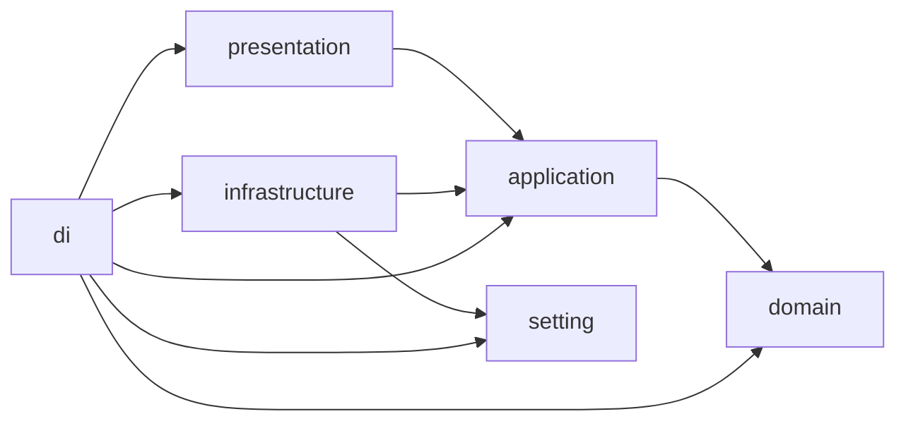

# Слоистая архитектура

Цель — заменять базу, транспорт, модель распознавания и другие реализации без
переписывания сценариев и бизнес-правил. Папки отражают ответственность кода.
Одного перемещения файлов для перехода на эту архитектуру недостаточно.

## Структура

Рабочие пакеты внутри `src/`. `src` — корневой Python-пакет проекта;
импорты имеют вид `from src.application...`, без изменения `sys.path`:

```text
src/
    presentation/     # роутеры, HTTP-схемы, адаптеры команд и заданий
    application/      # сценарии, DTO, интерфейсы внешних операций
    infrastructure/   # репозитории, клиенты сервисов, технические адаптеры
    domain/           # бизнес-модели, правила и ошибки
    setting/          # типизированные настройки
    di/               # сборка зависимостей и ресурсов
```

Внутри слоя группируем код по предметной задаче: например, расшифровка или
оценка звонка. Не создаём каталог заранее, если в нём ещё нет реализации.
Не складываем несвязанные задачи в общий `utils.py` или универсальный сервис.

### Presentation: как принимаем и отдаём запрос

Все HTTP-роуты находятся в `presentation`. Роутер принимает и валидирует
HTTP-ввод, формирует DTO сценария, вызывает `application` и преобразует
результат в ответ API. Здесь же ошибки сценария получают HTTP-представление.

HTTP-схемы объявляются роутерами `presentation`. Здесь остаются параметры запроса,
заголовки, cookies, коды ответа и особенности транспорта. Проверка технической
подлинности запроса может использовать внедрённый интерфейс; решение, разрешён
ли пользователю сценарий, обеспечивает `application` для любой точки входа.

Команда CLI и обработчик задания — тоже адаптеры входа: они переводят свой
ввод в DTO и вызывают тот же сценарий. Они не дублируют бизнес-логику роутера.

### Application: что делаем

Сценарий описывает последовательность действий: получить данные, применить
правила, вызвать нужные внешние операции и вернуть результат. Он отвечает за
права на действие и границы транзакции через соответствующие интерфейсы.

Сценарий использует `domain` для бизнес-решений. Для базы, хранилища, Whisper
и модели оценки он объявляет необходимые интерфейсы — порты. Порт содержит
типизированные операции, входы, выходы и ожидаемые ошибки; он не содержит SQL,
URL сервиса или типов конкретного SDK. Для портов используем `typing.Protocol`.

Порт принадлежит потребителю — `application`. Это позволяет заменить
реализацию, сохранив контракт сценария. Новый интерфейс создаём под реальную
операцию, а не под гипотетический универсальный CRUD.

### Infrastructure: как выполняем внешнюю операцию

Здесь находятся реализации портов: SQL и ORM, HTTP-клиенты, чтение записей,
вызов Whisper, разбор ответа внешнего сервиса и другие технические детали.
Адаптер возвращает DTO, объявленный в `application`, и переводит ошибки
библиотеки в ошибки контракта порта.

Адаптер не решает, какой звонок подлежит оценке и как вычислять бизнес-балл.
Параметры конкретного клиента, таймауты и технические повторы относятся сюда;
решение повторить целый бизнес-сценарий относится к `application`.

### Domain: бизнес-правила

Здесь находятся бизнес-модели, допустимые значения, ограничения и вычисления:
например, правила применимости оценки и расчёта результата по этапам.
Вход и выход доменных функций — явные типы и бизнес-модели.

`domain` не знает об HTTP, очереди, SQL, Whisper API или настройках окружения.
Время и прочие внешние значения передаются аргументами, если правило от них
зависит. Доменные модели могут использовать Pydantic `BaseModel`, но не
настройки, ORM-режим или транспортные объекты.

## Границы и зависимости

Стрелка означает разрешённый импорт, а не порядок сетевых вызовов:



| Пакет | Разрешённые зависимости внутри проекта |
|---|---|
| `presentation` | Свой слой, DTO, сценарии и ошибки `application` |
| `application` | Свой слой и `domain` |
| `infrastructure` | Свой слой, порты, DTO и ошибки `application`; типы настроек `setting` |
| `domain` | Только свой слой |
| `setting` | Только свой слой |
| `di` | Все слои для их сборки |

Внешние библиотеки разрешены по ответственности: FastAPI в `presentation`,
SQLAlchemy и HTTP-клиенты в `infrastructure`, Pydantic для моделей и схем,
Pydantic Settings в `setting`. Домен использует стандартную библиотеку и
Pydantic, не библиотеки ввода-вывода.

«Не перескакивать через слои» означает:

- роутер не вызывает доменное правило или инфраструктурный адаптер напрямую;
- сценарий не импортирует конкретный репозиторий или клиент;
- домен не вызывает `application` и не знает, кто его использует;
- технические объекты не выходят из своего адаптера;
- DI собирает объекты, но не принимает бизнес-решения.

Во время выполнения сценарий вызывает порт, за которым стоит внедрённый
адаптер. Поэтому вызов `application` → реализация в `infrastructure` допустим,
а прямой импорт этой реализации в `application` — нет.

Точка запуска обращается к сборке в `di`. Роутер получает уже собранный
сценарий через механизм внедрения; он не импортирует контейнер и не ищет
зависимости по строковому имени. Создание роутеров с зависимостями обеспечивает
сборка приложения.

## DTO и схемы

- DTO сценариев и портов принадлежат `application` и наследуются от
  Pydantic `BaseModel`. Используем именованные поля, явные типы и ограничения.
- Роутер описывает HTTP-ввод и собирает DTO сценария. Если форма результата
  совпадает с API, он использует тот же Pydantic DTO как `response_model`:
  `application/dto/api.py` и DTO административных операций. Модели не содержат
  FastAPI, cookies или объектов SQLAlchemy. Отдельную копию схемы создаём при
  различии её смысла или формы, а не ради второго имени одного набора полей.
- Внешний JSON, ORM-строка и ответ SDK преобразуются в DTO внутри
  `infrastructure`. Их формат не становится контрактом сценария.
- `application` преобразует DTO в бизнес-модель перед вызовом доменного правила
  и преобразует результат обратно. `domain` не импортирует DTO приложения.
- Валидация формы данных выполняется в схеме или DTO. Бизнес-решения выполняет
  домен: запрос к базе или выбор ветки сценария не помещаем в валидатор модели.
- Не используем `dict[str, Any]`, ORM-модель или HTTP `Request` как контракт
  между слоями. Коллекции DTO и явно типизированные простые значения допустимы.
- Не добавляем поля конкретного транспорта в общий DTO только ради удобства
  одного роутера или клиента. Не дублируем модель без различия в ответственности.

Ожидаемые ошибки домена сценарий переводит в ошибки своего контракта.
Инфраструктурный адаптер так же переводит ожидаемые ошибки внешней библиотеки
в ошибки порта. Роутер обрабатывает ошибки `application`, а не исключения ORM,
HTTP-клиента или домена. Не скрываем неожиданные ошибки общим перехватом.

Пример границ расшифровки:

1. Роутер преобразует запрос в DTO расшифровки и вызывает сценарий.
2. Сценарий получает сведения о записи через порт и проверяет бизнес-условия.
3. Сценарий вызывает порт распознавания. Клиент Whisper, внедрённый через DI,
   переводит DTO в запрос сервера и ответ сервера — в DTO результата.
4. Сценарий применяет необходимые доменные правила и сохраняет результат через
   порт репозитория.
5. Роутер преобразует итоговый DTO в HTTP-ответ.

Реальный маршрут конвейера: `application/pipeline/transcribe.py` использует
порты из `application/ports/`, DTO из `application/dto/` и правила определения
ролей; `di/pipeline.py` внедряет чтение и запись PostgreSQL, хранилище,
обработку ffmpeg и выбранный клиент распознавания. Универсальный транспорт
распознавания собран отдельно в `di/transcription.py`.

## Настройки и DI

`setting` содержит модели конфигурации на Pydantic Settings `BaseSettings`.
Окружение и `.env` читаются здесь; поля типизированы и проверяются до запуска
обработки. Связанные настройки можно группировать в модели `BaseModel`.
Настройки описывают конфигурацию, а не создают подключения или клиентов.

`di` загружает настройки, создаёт адаптеры и передаёт их сценариям через порты.
В инфраструктурный адаптер передаём только необходимые параметры либо
соответствующую группу настроек. Он может импортировать её тип, но не загружает
`BaseSettings` самостоятельно. В `application` передаём явные параметры
сценария; весь объект настроек ему не нужен.

DI управляет временем жизни ресурсов: запуском и закрытием клиентов, пулов,
сессий и ресурсов отдельного запроса или задания. Не создаём их при импорте
модуля и не используем глобальный контейнер из бизнес-кода.

Конкретная библиотека DI этими правилами не выбрана. Выбор инструмента сборки
не должен менять контракты сценариев или связывать их с этой библиотекой.

## Транзакции и ресурсы

У обработки задания две фазы. `work` получает DTO-снимок, закрывает сессию
чтения и выполняет долгие внешние вызовы. `store` принимает порт
`StagePersistence`; исполнитель в `infrastructure/queue/worker.py` передаёт
адаптер своей транзакции. Сохранение результата, завершение задания и
постановка следующего этапа фиксируются вместе. Порт записи не делает commit.

При изменении ролей адаптер записи удаляет оценку в той же транзакции.
Пакетная оценка перечитывает актуальность исходных данных перед сохранением;
ожидание модели не держит транзакцию открытой. Сценарии истории, свежего
приёма, заполнения причин и повторного анализа имеют отдельные порты хранения.

Справочники согласует `application/catalogues/directories.py` через
`DirectorySource` и `DirectoryRepository`. Домен решает, как объединить
активных и уволенных сотрудников; адаптер SQL сохраняет изменения в транзакции
вызывающего. Отсутствующие сотрудники помечаются уволенными, исторические
проекты сохраняются. Проекты без UUID источника в синхронизацию NCC не входят.

Период запроса разрешается в application до обращения к репозиторию.
Пороги разрядов качества и обязательность этапов принадлежат
`domain/quality/reporting.py`; SQL использует эти же правила для агрегатов.

`di/requests.py` собирает сценарии одного HTTP-запроса на общей сессии.
Проверка прав выполняется сценарием до обращения к хранилищу или поиска.
Ошибки `ApplicationError` переводятся в HTTP в `presentation/http/responses.py`.

Поток записи — специальный ресурсный результат: `RecordingStream` содержит
итератор байтов и функцию закрытия, не объект `httpx.Response`. HTTP-адаптер
закрывает его через `BackgroundTask`. Временный рабочий каталог конвейера
создаёт и очищает `TemporaryRecordingWorkspace` за портом `RecordingWorkspace`.

Обычные DTO состоят из значений. `arbitrary_types_allowed` нужен только моделям
ресурсов и зависимостей с портами или потоками. Protocol в такой Pydantic-модели
помечается `runtime_checkable`, иначе построение валидатора завершается ошибкой.

Пул базы кэшируется по адресу, параметрам подключения и event loop. Нельзя
использовать подключение asyncpg из другого event loop. Команды истории и
синхронизации выполняют все свои операции внутри одного `asyncio.run`.

## Точки запуска и совместимость

Миграции находятся в `alembic/`, конфигурация — в `alembic.ini`:
`alembic -c alembic.ini upgrade head`. При переименовании сохранены идентификаторы
ревизий и исполняемый код миграций. Docker и локальный запуск используют новое
имя конфигурации.

HTTP запускается фабрикой:

```bash
.venv/bin/uvicorn src.di.http:create_app --factory --port 8096
```

Импорт `src.di.http` не читает окружение и не создаёт приложение. CLI находятся
в `presentation/cli`: парсеры принимают аргументы, а локальный импорт внутри
`main` обращается к сборке в DI. Это единственное разрешённое исключение для
импорта `presentation` → `di`; HTTP-роутеры получают сборку через зависимости.

В `app/` остаются только обёртки старых CLI и `app.speech_service.main:app`.
Последняя создаёт приложение как явная совместимая ASGI-точка входа.
Исходники и новые сценарии никогда не импортируют `app/`.

JSON-справочники находятся в `infrastructure/data/`, проверяются правилами
`domain/calls/catalogues.py` через application и включены в пакет через
`tool.setuptools.package-data`. Проверять чтение нужно и из установленного wheel.
