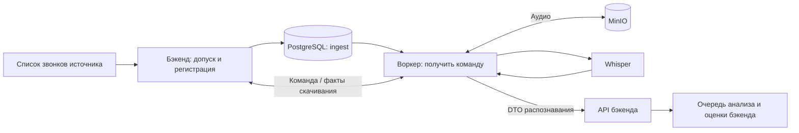

# Приём записей: владелец правил — бэкенд

Состояние 14.10.2026. Приём метаданных, допуск проектов, расписание, дневная
доля, приоритеты, история, короткие записи, ожидание отсутствующей записи и
выбор следующего этапа перенесены из `speech-worker` в `speech-backend`.
Сервер пока не переключён. Текущая сборка требует `sp_0017_analysis_storage`;
добавочная миграция анализа не меняет контракт приёма и прежние колонки звонка.

## Текущий путь



`IntakeSchedule` в CPU-процессе `speech-process` запрашивает метаданные,
регистрирует звонки и ставит `ingest`. Сам бэкенд на этом пути аудио не качает,
ffmpeg и GPU ему не нужны. У каждого источника и постановки оценки свой цикл;
ожидание источника не задерживает LLM, второй источник или оценку.
Один CPU-процесс по-прежнему последовательно исполняет `analyze`/`evaluate`.
Воркер последовательно исполняет `ingest`/`transcribe`, по одной записи.

## Сохраняемые правила

| Решение | Исполнение в бэкенде |
| --- | --- |
| Допуск проекта | `application/ingestion/daily.py`: выключенный сбор не заводит звонок/задание |
| Телесейлз (`ncc`) | Раз в 15 минут; днём доля 0.5, остальные с 19:00; ночью всё сразу |
| Телфин | Раз в час, 19:00–07:00 по Москве; приоритет 20 |
| Срочность | Свежие NCC 0, отложенные 10, Телфин 20, история 100 |
| Повтор приёма | Дополнение недостающих метаданных; существующее задание, его приоритет и `not_before` не меняются |
| История | Вчера/сегодня, затем порция истории Телфина; ручная история NCC через `speech-backfill` |
| Короткая запись | Заявленная длительность строго между 0 и порогом; ноль — неизвестная длина |
| Запись отсутствует | До предела попыток повтор; последняя попытка — `skipped_no_audio`, без `failed` |
| Успешное скачивание | `transcribe` с полосой и приоритетом исходного задания |
| После ASR | API бэкенда атомарно сохраняет текст и ставит `analyze`; независимая оценка — только Телфин |

Жребий дневной доли бросается при создании первого задания. Перед выбором
проверяется наличие `ingest` в любом состоянии. Дополнительно уникальный ключ
`(call_id, kind)` защищает постановку. Вся регистрация дня и его курсор — одна
транзакция; HTTP источника выполняется до неё. Ограниченная порция не закрывает сутки.

При продвижении истории SQL сравнивает исходные окно, курсор, паузу и `done`.
Поздний шаг не отменяет паузу и не сдвигает заново открытое окно. Открытие
активного окна требует явного `--restart`, в том числе при конкурентном запуске.
После аварии между регистрацией суток и продвижением курсора день повторяется
без повторной постановки. Исторические окна и существующие курсоры сохранены.

Фильтры исходящих/соединённых вызовов Телфина, исключения добавочных/групп,
минимальная длительность источников, нормализация классификации и маска/хеш
номера остались в бэкенде. Их второй реализации в воркере больше нет.
`ncc` в этих проектах означает Телесейлз; добавление Телематики сюда — отдельная
интеграция. Старые репозитории для этой задачи не использовались.

## Служебные команды ingest 1.0

- `POST /internal/v1/ingest/prepare`: `IngestClaim` → `IngestPlan`.
- `POST /internal/v1/ingest/resolve`: `ResolveIngest` → `IngestResolution`.

В обоих запросах нужны совпадающий `SPEECH_WORKER_API_TOKEN` и конкретный захват:
UUID звонка/задания, nonce, имя воркера, номер попытки. Проверяются вид `ingest`,
состояние `running` и живая аренда по часам PostgreSQL. Маршруты скрыты из
пользовательского OpenAPI; неверный ключ отклоняется до создания пула.
Ошибки не отражают URL записи, тело запроса или ключ.

`prepare` возвращает либо готовое завершение без скачивания, либо локатор
источника, ключ MinIO и команду проверки ранее сохранённого объекта.
Пороги, дневная доля и история в команду не входят. Решение и измерения
проекта фиксируются в `_ingest_admission` задания для текущего nonce;
секретный URL и номер клиента туда не копируются. Изменение настроек посреди
скачивания не переигрывает решение этой попытки. Новый nonce читает новые настройки.

Воркер скачивает/измеряет/сохраняет файл и передаёт только `stored` с ключом и
измерениями либо `missing`. Сетевой отказ источника, пустой файл и неисправное
аудио не превращаются в `missing`. Бэкенд возвращает повтор либо DTO готовых
изменений и следующего этапа. Другой ключ или устаревший nonce отклоняются.
HTTP 408/409/429/5xx и транспортный сбой управления откладывают задание без
расхода попытки скачивания. Воркер не выбирает, сколько ждать отсутствующую запись.

## Транзакция результата и пределы гарантии

Для `ingest` сохранена общая очередь PostgreSQL: воркер технически применяет
полученные от бэкенда данные/статус и ставит указанный им этап в одной
транзакции с `done`. Финальный UPDATE проверяет nonce и живую аренду через
`clock_timestamp()`; проигрыш откатывает измерения, статус и постановку.
`_ingest_admission` удаляется при успешном завершении. Локальный обработчик
не вычисляет короткий звонок, отсутствие записи или следующий вид задания.

Это отличается от доставки ASR: её текст, завершение и анализ атомарно
записывает сам API бэкенда; воркер хранит буфер до квитанции.
[Гарантии ASR](transcription-delivery.md).

Для скачивания нет отдельного долговременного outbox: авария до commit может
повторить получение/загрузку по тому же ключу MinIO. Запрос к Whisper при этом
ещё не выполнялся. Авария между загрузкой объекта и commit может оставить
объект без подтверждённых метаданных — это существующая граница, требующая
учёта при завершении политики хранения. Не удалять такие объекты по возрасту
локального временного файла или неподтверждённого задания.

## Запуск и совместимость

Автоматический приём перенесён в `speech-process`. Выбор источников:

```bash
uv run --locked speech-process
uv run --locked speech-process --sources ncc
uv run --locked speech-process --sources '' --no-schedule
```

Последний вариант обрабатывает только уже поставленные LLM-задания.
`--no-schedule` отключает только постановку оценки. `--once` не запускает
автоматический приём метаданных; сохранён прежний режим одной обработки.
`speech-analyze` остаётся командой только анализа, без автоматического приёма.

В бэкенде зарегистрированы ручные команды с прежними параметрами:

```bash
uv run --locked speech-ingest --date 2026-10-14 --source ncc
uv run --locked speech-backfill status
uv run --locked speech-backfill start --days 60
uv run --locked speech-backfill run --days 1
```

Прямой ручной приём сохраняет явные флаги доли/приоритета; если нужна политика
автоматического расписания, использовать `speech-process`. При ручном запуске
оператор выбирает параметры осознанно, как и раньше.

В воркере удалены `speech-ingest`, `speech-backfill`, `--sources`, `--queue-only`,
планировщик, правила истории, SQL регистрации дня и клиенты списков звонков.
Основная команда всегда обрабатывает очередь. Старый `/internal/v1/worker-plan`
удалён после удаления его потребителя. Новый воркер требует API с двумя
маршрутами ingest и существующим приёмом ASR. Версии этих процессов переключаются
согласованно; одинаковой ревизии схемы недостаточно.

В бэкенде нужны reporting-настройки NCC, секреты API Телфина, фильтры и глубина
истории; в воркере — только доступ к скачиванию NCC, таймаут Телфина, MinIO,
Whisper и служебный API. Для `local_export` файл по переданному абсолютному
локатору должен быть доступен обоим процессам с одинаковым путём, например
через read-only mount. Это локальный режим, не передача файла через API бэкенда.
Рабочие `.env` сохранены: перенесённые поля в воркере игнорируются.

## Что осталось

Старый исполнитель получения/Whisper удалён 14.10.2026; API чтения аудио,
ORM и миграции сохранены. [Проверка потребителей](audio-worker-removal.md).

1. Завершить перенос решений справочников и хранения: `speech-sync-directories`
   и `speech-prune` пока остаются в воркере; техническое удаление может остаться там.
2. После очистки потребителей сократить оставшиеся Settings/Compose/зависимости.
3. Пройти живые источники → MinIO → Whisper → API → LLM → оценку и пользовательскую
   выдачу, проверить очистку контейнера Whisper, подготовить выкладку/откат и
   согласованно переключить сервер. Новые процессы здесь не развёртывались.

[Общий план](refactoring-plan.md). GigaAM, батчи, повышение параллелизма и
разделение общей базы не входят в текущий шаг.

## Проверки выполненного шага

Проверки 14.10.2026: Ruff, форматирование и строгий mypy обоих проектов;
полные тесты с собственной PostgreSQL и миграциями — бэкенд 1525 passed,
21 skipped, воркер 379 passed. Пропуски относятся только к скриптам отсутствующего
репозитория инфраструктуры; PostgreSQL-проверки выполнены. Бизнес-тесты
регистрации, источников, классификации и телефона сохранены в бэкенде,
дубли удалены из воркера. Новые проверки подтверждают границы ночи,
повтор без нового жребия, историю после паузы/смены окна, отсутствие секретов
в ошибках, привязку команды к nonce и rollback при потере аренды на последнем UPDATE.

UV lock, wheel/sdist и Docker API/CPU/воркера проверены. Установленные пакеты
вне исходников запускают все 11 команд бэкенда и 3 воркера под UID 10001.
CPU не содержит ffmpeg/PyTorch; воркер не содержит клиентов метаданных,
правил телефона и LLM. Четыре JSON Schema ingest совпадают в обоих проектах.
Сквозной прогон отдельных контейнеров на синтетическом аудио использует
настоящие HTTP, ffmpeg и временную PostgreSQL, подставные S3/Whisper/LLM:
приём и его повтор → ingest → transcribe → API ASR → CPU-анализ, все задания done.
LLM вызывал только CPU-процесс. Это не проверка качества живых моделей.
Временные контейнеры удалены; рабочие сервисы не затрагивались.
