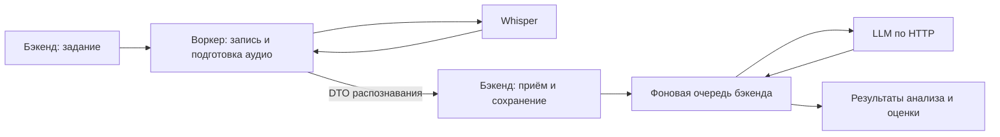

# Главное правило: воркер распознаёт, бэкенд обрабатывает результат

Решение владельца 13.10.2026. Это целевая граница ответственности для всех
следующих изменений. Она заменяет прежний план, в котором воркер выполнял
готовые LLM-запросы бэкенда.

## Правило

**`speech-worker` получает запись, готовит аудио, вызывает распознавание,
получает результат и передаёт его `speech-backend`. Бэкенд принимает и
сохраняет расшифровку, определяет дальнейшие действия, вызывает LLM,
проверяет ответы, анализирует разговор и сохраняет окончательные результаты.**

В целевом воркере нет вызовов LLM, анализа текста, оценки продаж или записи
их итогов в бизнес-таблицы. Это относится и к техническому выполнению готового
промпта: сам HTTP-вызов LLM тоже принадлежит бэкенду.

## Владельцы операций

| Операция | Владелец |
| --- | --- |
| Расписание, допуск звонков, приоритеты, отсрочка, выбор дальнейших этапов | Бэкенд |
| Получение списка записей через адаптер источника и скачивание | Воркер, по заданию бэкенда |
| Сохранение оригинала в MinIO, подготовка WAV, измерение аудиоканалов | Воркер |
| Вызов Whisper и получение текста, сегментов и таймкодов | Воркер |
| Надёжная доставка DTO распознавания и очистка собственных временных копий | Воркер |
| Приём DTO, проверка актуальности, сохранение расшифровки и постановка обработки | Бэкенд |
| Промпты, выбор LLM, её адреса/ключи и HTTP-вызовы | Бэкенд |
| Роли по тексту, классификация, тональность, резюме и причины обращения | Бэкенд |
| Выбор звонков Телфина для оценки, скрипт продаж, баллы и объяснения | Бэкенд |
| Сохранение результатов анализа/оценки и выдача пользователю | Бэкенд |

Воркеру остаются технические операции его заданий: захват, heartbeat,
повторы скачивания/распознавания/доставки и восстановление после остановки.
Это не разрешает ему выбирать последующие бизнес-этапы. Использование общей
очереди PostgreSQL само по себе не меняет владельца бизнес-записи.

Измерение энергии аудиоканалов остаётся в воркере. Правила применения
измерений и допустимости замены ролей принадлежат бэкенду.

## Целевой путь записи

Бэкенд работает на CPU. Для вызова внешней LLM ему не нужны CUDA или локальные
веса модели. GPU использует сервер модели. Воркер размещается на GPU-сервере
без Kubernetes и пока вызывает существующий Whisper по HTTP; собственных
CUDA/PyTorch-зависимостей в текущем коде не добавляем.

Долгие вызовы LLM выполняет надёжный фоновый обработчик из репозитория
`speech-backend`. API приёма расшифровки подтверждает сохранение и постановку
задания, не ожидая анализа. Такой обработчик может быть отдельным CPU-процессом
того же проекта; новый репозиторий для него не создаём. Фоновую работу
нельзя терять при перезапуске API.

В PostgreSQL остаётся существующая очередь. После перехода задания получения
и распознавания исполняет `speech-worker`, анализ и оценку — бэкенд.
Разделение процессов не разрешает само по себе повысить согласованный
параллелизм модельных вызовов. Сохраняем последовательное распознавание,
одну запись за запрос и прежние ограничения нагрузки.

## Приём результата и повторы

Сторона бэкенда реализована 13.10.2026:
[служебный контракт приёма 1.0](transcription-delivery.md).
Вход содержит идентификаторы захвата, снимок аудио, сведения о модели,
реплики, таймкоды и технические данные. Аудио и секреты через него не передаются.
Совместимый nonce и надёжная доставка в `speech-worker` подключены:
[буфер и восстановление](../../speech-worker/docs/transcription-delivery.md).

Приём должен обеспечивать:

- Служебную авторизацию и проверку соответствия результата выданному заданию.
- Защиту от устаревшей попытки, потери аренды и повторной обработки звонка.
- Идемпотентность: повтор доставки после таймаута возвращает подтверждение
  уже принятого результата, не создавая второй транскрипт или новое задание.
- Атомарную фиксацию расшифровки, состояния задания распознавания и следующего
  этапа обработки. Две стороны не завершают одно задание независимо.
- Подтверждение после commit. Потеря HTTP-ответа после commit допускает
  безопасную повторную доставку.

Воркер освобождает собственные временные копии при завершении операции;
неподтверждённый результат должен оставаться восстанавливаемым при сбое.
Результат хранится в `speech_jobs.payload._transcription_delivery` до commit
бэкенда; commit атомарно убирает буфер. Отмена и сетевой сбой сохраняют его.
Отсутствие временного WAV не должно считаться подтверждением приёма бэкендом.
Оригинал в MinIO остаётся на отдельной машине и сохраняется по прежней политике.

Сетевые вызовы и модельная обработка выполняются вне транзакций записи.
Срок ожидания API приёма не включает ожидание LLM. Повторы приёма, анализ
и оценка должны сохранять прежние приоритеты и пользовательские статусы.

## Фактическое состояние на дату решения

Правило ещё не реализовано целиком. Основной `speech-worker` исполняет только
`ingest`/`transcribe`, доставляет ASR и не создаёт клиентов LLM. Его отдельные
LLM-команды, настройки и служебные маршруты сохранены до переноса потребителей.
CPU-команда `speech-analyze` уже выполняет `analyze`: локальная подготовка
промпта, прямой HTTP к LLM и атомарная запись с завершением задания.
Оценка `evaluate` переносится следующим отдельным шагом.
[Фоновый анализ и восстановление](analysis-processing.md).

Бэкенд уже принимает распознавание, проверяет nonce/аренду и атомарно
сохраняет текст с постановкой анализа. Квитанция хранится в существующих
метаданных задания, новая миграция не нужна. Воркер использует этот маршрут;
таблицы расшифровки и завершение ASR он сам больше не пишет.

Выделенный `AnalysisInterpretationService` используется фоновым сценарием
бэкенда через `AnalysisExecutionService`. Передавать LLM-ответ из воркера
этому сервису через новый HTTP-маршрут больше не планируем.

Рабочие `.env`, текущая схема `sp_0016_evaluation_jobs`, исходные проекты
и действующие сервисы этим решением автоматически не меняются. Переключение
потребует согласованного запуска обработчиков двух проектов.

GigaAM, батчи, увеличение параллелизма, замена брокера и разделение базы
остаются отдельными будущими задачами. Не вводим их ради этого перехода.

Порядок реализации и уже выполненные шаги:
[план завершения разделения](refactoring-plan.md).
